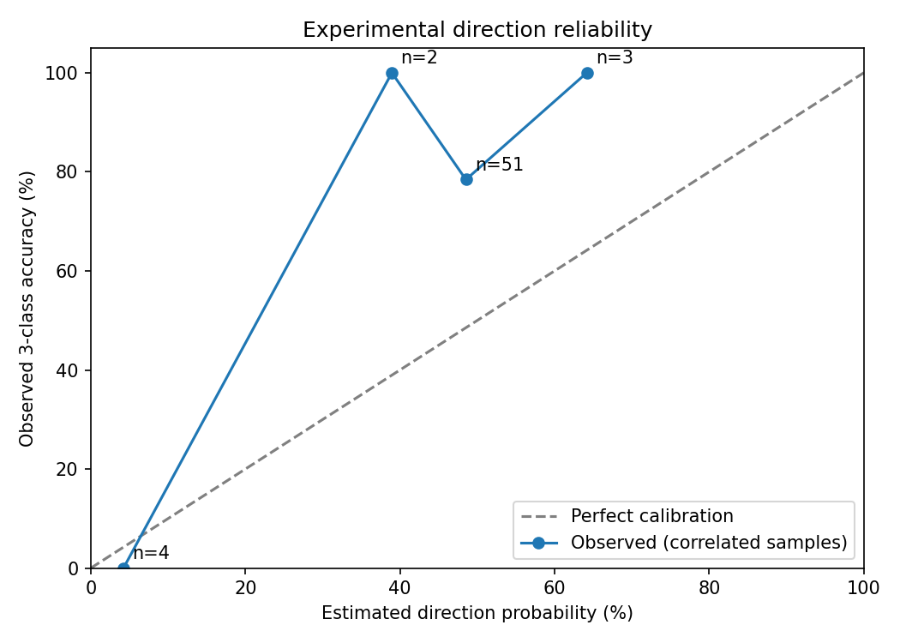

# 黄金回测与改进：2026-11-03

## 结论

最新可用上期所交易日为 11 月 2 日，并非 11 月 3 日盘中实时价格。
短期模型尚未稳定优于不变价预测；长周期方向较好但严重低估下跌幅度。
本次改进评测与版本放行逻辑，没有根据六天行情过拟合生产参数，也没有提升对外置信度。

## 数据与方法

- Sina/akshare 上期所 AU0 连续黄金期货，4581 条日线，2008-01-09 至 2026-11-02。
- 跨市场输入为 Yahoo COMEX GC=F、汇率以及 DXY/VIX/美国国债收益率。
- 每个预测起点重新训练，训练窗口 240；截断跨市场数据并沿用模型的数据可用时间过滤。未使用 COT。
- 目标日 2026-10-26 至 2026-11-02，共六个交易日；15 个历史起点、60 条成熟预测，每期限六条。
- 这是用当前代码重建的历史预测，不是当时已归档的实时预测；连续合约换月和数据源修订仍可能影响结果。
- 本报告不是上金所现货回测，也不是独立的 COMEX 期货预测回测。

## 价格与方向

MAE 单位为元/克；v0 为不变价，v1 为原始模型，v7 为现有收缩版本。
正向收缩不改变预测涨跌符号，因此 v7 的符号命中率和 v1 相同，不代表方向改进。

| 期限 | 样本 | v1 MAE | v7 MAE | v0 MAE | v1/v7 符号命中率 | 不重叠样本 |
|---|---:|---:|---:|---:|---:|---:|
| T+1 | 6 | 9.27 | 6.71 | 6.68 | 66.67% | 6 |
| T+3 | 6 | 15.32 | 14.43 | 14.81 | 66.67% | 2 |
| T+5 | 6 | 23.24 | 23.22 | 23.22 | 66.67% | 2 |
| T+10 | 6 | 37.12 | 42.21 | 42.78 | 100.00% | 1 |

T+1~3 合并符号命中率 61.11%、MAPE 1.59%；T+5~10 为 88.89%、MAPE 3.60%。
重叠目标和同一轮下跌会抬高表面样本量。T+10 的 100% 只有一个不重叠区间，不能推断可靠性。
v7 在 T+10 比原始模型更差，说明统一缩小幅度会错失持续趋势。

## 置信度审计

下表按上涨/下跌/横盘三分类概率评估，与上面的简单符号准确率不同。

| 区间 | 样本 | 三分类命中率 | 平均预测信心 | Brier（越低越好） | 对称先验 Brier |
|---|---:|---:|---:|---:|---:|
| T+1~3 | 18 | 55.56% | 47.07% | 0.4750 | 0.5510 |
| T+5~10 | 36 | 88.89% | 46.62% | 0.5119 | 0.5038 |

长周期概率评分仍差于对称先验，不能把高方向命中率直接改写为高置信度。
所有分组 supported_n=0；当前样本不足以支持“经过验证的高可信概率”。
价格区间覆盖率不是方向置信度。

## 失真实例与原因

- 10/30 起点预测 11/02 为 850.12，实际 836.76；方向正确但仅预测下跌 5.06，实际下跌 18.42。
- 10/28 起点 T+3 预测 873.10，实际 836.76：局部反弹被外推为上涨。
- 10/26 起点 T+5 触发 delayed_capitulation_rebound_release，预测 864.33，实际 836.76；反弹释放规则在持续下跌中失效。
- 10/19 起点 T+10 预测 897.82，实际 836.76：预测跌幅 4.60，实际跌幅 65.66。
- 上述现象支持检查反弹规则、趋势幅度收缩与波动状态适配，但不足以确定单一因果或最优参数。

## 已实现改进

1. 修复排行榜用 T+10 混入短期均值的问题，按约定 T+1/3/5 计算 skill。
2. 缺失必需期限、覆盖率、非有限统计、重复期限时拒绝放行；拒绝未成熟实际价格。
3. 新增按期限预先选取不重叠标签的方向审计及 95% Wilson 区间；不足 30 条不得声明方向优势。
4. 修正文档中与代码不一致的筛选规则；保留原有 -2% skill 容忍带，但负 skill 明确不代表优于基线。
5. 未通过筛选时返回 no_eligible_model，避免将样本不足误报为全模型负收益/负 skill。

近期六天样本没有任何候选通过门槛，审计推荐回退 v0；没有自动部署该推荐。
冻结旧样本（261 条、69 个起点）修正后 v7 短期平均 skill 为 -1.73%，旧口径为 -1.31%。
这属于统计口径修复，不是预测变差；旧样本未重新训练当前模型，只重新比较收缩版本。

## 下一轮实验建议

1. 将反弹释放规则做开/关消融，分持续下跌、反转和震荡状态评估，不能只针对本周关闭。
2. 对 T+1~3 和 T+5~10 分开做趋势强度与波动率条件收缩；与不变价、近期趋势延续基线共同比较。
3. 用更长的滚动训练/验证段选择参数，保留后续未参与选择的测试段；概率校准只使用当时已成熟标签。
4. 按不重叠样本报告概率可靠性、Brier、方向覆盖率与区间；证据不足维持低信心或不输出方向建议。

## 产物与回退

- `live/`：逐条预测、期限汇总和原始报告。
- `recent_versions/`：新行情版本对比；`frozen/`：冻结旧样本复测。
- `confidence/`：概率指标、阈值审计及可靠性图。
- 生产参数、config、cron 和预测入口均未改动。审计 calibration.json 不得自动发布为生产校准。
- 代码变更仅限 benchmark、测试及文档，可用独立提交回退。
