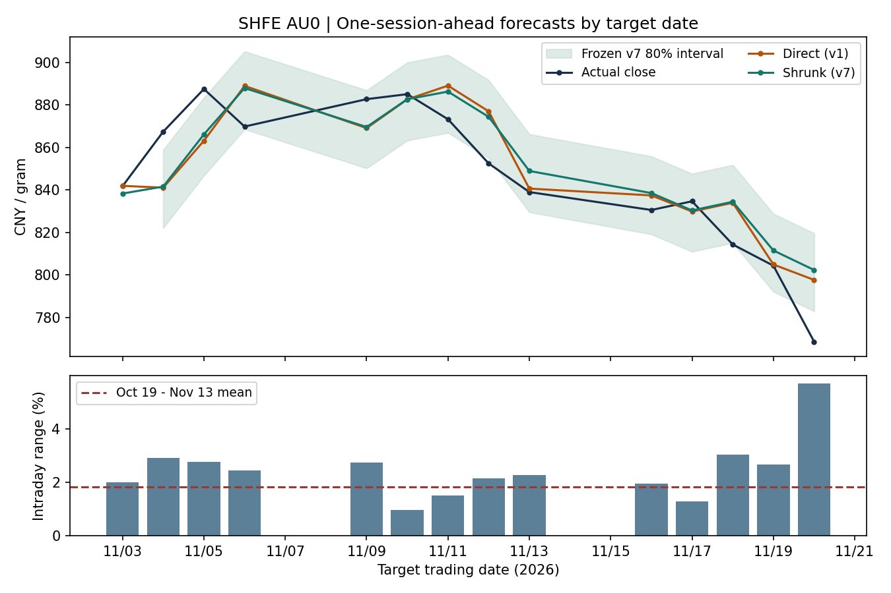

# 黄金波动压力回测：2026-11-23

**汇报版：最近五日沪金连续期货下跌 8.40%，平均日内振幅比此前二十日放大 62%。次日预测在跌势中能减少部分价格误差，但不能稳定识别反弹；中期风险区间没有兜住本轮下跌。建议先修行情交付和下行区间，不调高涨跌信心，不替换现有模型。**

## 1. 这次测的是什么

- 预测目标为新浪/AKShare 的沪金连续期货 AU0 收盘价，单位元/克，不是上金所现货、某个月份的合约、夜盘分时或结算价。信号按上海时间起点交易日 16:00 构造；16:00 是信息截止时间，不是交易所收盘时刻。
- 接续上次实际行情截止日 11/02；本次同口径取得的最后一根完整日线为 11/20。成熟目标日 11/03 至 11/20，共 14 个交易日。10/20 至 11/19 的 23 个起点分别重训，T+1 至 T+10 各 14 条，共 140 条。没有用 11/23 的盘中、延时或其他品种报价补标签。
- 系统版本 `fb51fdbf46f231c3de5a34e5fe4641428e63a5d8`；direct 模型，lookback=240。完整组使用 AU0、COMEX GC=F、USD/CNY、DXY、VIX、美债十年期收益率；另跑仅 AU0 组，按相同起点和目标重训。两组均未传 COT，未重放历史新闻或事件情景层，未模拟交易成本、仓位和收益。本报告是历史重建，**不是**当日已向飞书发出的预测或逐日生产版本选择记录。
- AU0 共 4,595 行；跨市场是 Yahoo 同品种 chart 接口的未调整收盘价（默认 yfinance 被限流）。COMEX 979 行、汇率 1,010 行、跨市场合并 980 行，截止均为 11/20。按品种交易时区确定日期，无显式发布时间的海外日线遵循项目默认：次日上海 08:00 后才可用，没有将美国周五收盘倒灌到中国周五预测。数据为本次抓取的历史版本，不能排除事后修订或连续合约换月的影响。
- 交叉核验：11/20 上金所 Au99.99 收 764.55 元/克，日跌 4.66%，支持当日国内现货也大幅下跌；没有拿它替代 AU0 的 768.56。[上金所当日官方行情](https://www.sge.com.cn/h5_sjzx/quotationdailynew?end_date=2026-11-20&start_date=2026-11-20)。期货输入参见[新浪 AU0](https://finance.sina.com.cn/futures/quotes/AU0.shtml) 和 [Yahoo COMEX 黄金历史行情](https://finance.yahoo.com/quote/GC%3DF/history/)。

## 2. 波动有没有变大

| 口径 | 样本 | 平均绝对日涨跌 | 平均日内振幅 | 收盘年化波动率 |
|---|---:|---:|---:|---:|
| 10/19 至 11/13，前二十日 | 20 | 1.20% | 1.81% | 23.50% |
| 11/16 至 11/20，最近五日 | 5 | 1.92% | 2.93% | 29.89% |

日内振幅为 (最高价−最低价)/昨收；年化波动率为日对数收益样本标准差乘 √252，不宜用五日估计预测全年。上周五个交易日中四跌一涨，11/13 至 11/20 从 839.00 到 768.56。11/20 单日跌 35.76 元/克（4.45%），日内振幅 5.71%。这是已实现的波动，不代表事前已知道周五会跌。

## 3. 方向与价格

v0 为不变价；v1 是包含保护规则的 direct 路径；v7 是按期限缩小 v1 的预测变化量，非独立方向模型。下表 MAE 是平均绝对价格误差，单位元/克，越低越好。方向是相对预测起点的涨跌符号，不是相对目标前一日；动量基准只猜方向，取起点过去三个交易日价格变化的符号。

| 期限 | v1 符号命中 | 三日动量命中 | v0 MAE | v1 MAE | v7 MAE | 仅沪金 v1 MAE | 不重叠区间数 |
|---|---:|---:|---:|---:|---:|---:|---:|
| T+1 | 6/14 | 9/14 | 14.89 | **13.51** | 14.47 | 14.68 | 14 |
| T+2 | 9/14 | 9/14 | 21.95 | **19.74** | 21.25 | 22.40 | 7 |
| T+3 | 4/14 | 7/14 | **27.98** | 28.11 | 28.01 | 29.73 | 5 |
| T+5 | 6/14 | 7/14 | **35.41** | 35.79 | 35.48 | 37.16 | 3 |
| T+10 | 7/14 | 6/14 | 29.51 | **29.18** | 29.48 | 29.56 | 2 |

相对上次六个目标日，T+1~3 合并符号命中率从 61.11% 降到 45.24%（19/42），MAPE 从 1.59% 升到 2.44%；T+5~10 从 88.89% 降到 39.29%（33/84），MAPE 从 3.60% 升到 4.19%。这是不同市场窗口的描述，不是显著性检验。T+1 的 95% Wilson 方向区间为 21.4% 至 67.4%；T+10 只有两个不重叠区间。

**短线的非对称性：**T+1 全期 8 个下跌日猜对 5 个，6 个上涨日只猜对 1 个。最近五日 v1 五次全猜跌，命中 4/5，等于同期始终猜跌的结果；不过价格 MAE 由不变价的 15.73 降至 12.19。不能把猜中这波单边走势解释为对反转判断也可靠。完整跨市场组在上表各期限均比仅沪金组 MAE 低；不支持直接删掉外盘输入，也不证明任一单独特征有因果作用。

### 最近五日 T+1，按目标日排列

| 目标日 | 起点收盘 | v1 | v7 | 实际 | v1 方向信心 | v7 冻结 80% 区间 |
|---|---:|---:|---:|---:|---:|---:|
| 11/16 | 839.00 | 837.43 | 838.53 | 830.56 | 51.1% | 819.15–855.80 |
| 11/17 | 830.56 | 829.85 | 830.35 | 834.66 | 56.0% | 810.97–847.62 |
| 11/18 | 834.66 | 833.95 | 834.45 | 814.32 | 48.8% | 815.07–851.72 |
| 11/19 | 814.32 | 804.89 | 811.49 | 804.32 | 53.8% | 792.11–828.76 |
| 11/20 | 804.32 | 797.62 | 802.31 | **768.56** | 59.8% | **782.93–819.58** |



## 4. 风险从哪里来

1. **系统可能先于模型失效。** 本机 11/23 09:00 的 direct 日志显示 GC=F 被限流，因空数据异常退出，没有该次预测。这不是模型猜错。本次通过同一供应商的备用接口补齐；备用接口不能防止供应商整体故障。另一入口的 `scripts/gold_daily.py::_cached_fetch` 有缓存，但读取时没有按品种禁止过期数据。两个入口的降级语义不一致。
2. **价格风险区间失守，而非单纯“方向猜反”。** 11/20 次日 v1 看跌 6.70，v7 仅看跌 2.01，实际跌 35.76；实价低于 v7 区间下沿 14.37。评估的是 11/02 已入库的 v7 80% 残差区间，非 direct 情景上下沿，且仅纳入 11/02 后发起的预测。全期 T+1 覆盖 8/13、T+5 覆盖 4/9；最近五个目标日分别为 **3/5、0/5**，五个 T+5 全从下沿漏出。不能只靠加宽区间改善指标，必须同时看宽度与超界损失。
3. **状态切换慢，和额外收缩是两个不同问题。** 全部 14 个 T+1 起点均标记 normal。11/19 收盘时，生产口径二十日年化波动率约 24.9%，没过 30% 的 high 门槛；但当时已知的五日平均日内振幅已是此前二十日的 1.29 倍。周五全部行情加入后该比值才是 1.62。v1 使用收益保护和状态衰减；v7 又乘 0.30/0.25/0.20/0.10。收缩确实拉小了这次跌幅预测，但不能仅据一周断定该全局放松哪个保护参数。
4. **涨跌置信度和价格区间不能共用一个百分比。** 按上涨/横盘/下跌（横盘为 ±0.5 元/克）评估，T+1~3 三分类命中 42.86%，平均信心 48.73%；T+5~10 分别为 39.29%、49.46%。两组 Brier 分别为 0.4690、0.5032，略优于对称先验 0.5038、0.5139，不能据此声称“概率完全没用”，也不能调高信心。140 条中只有 1 条被程序标记 supported（T+3，67.0%，方向正确但价格仍偏 54.37 元/克）；其余 139 条未达到该标记。支持样本不是经过验证的胜率。

## 5. 讨论方案，不改生产

| 优先级 | 先做什么 | 如何判定值得上线 |
|---|---|---|
| P0：先保证有可信的报告 | 统一 cron 与日更入口的数据读取；限流时先同品种备用接口，再按各市场交易日历检查缓存。沪金目标过期只发“无新预测”；可选外盘缺失则明确标降级，用单独验证过的降级模型，否则只发数据告警。保存每次实际发送的版本、预测、行情截止与哈希。 | 故障演练含限流、过期、跨中美节假日、部分字段陈旧；不把旧预测当新预测，不静默退出，且能按当日发送记录验收。 |
| P1：先试下行区间，而非放大点预测 | 保留 v1/v7/v0；并行增加一个只改区间的候选。用起点已知的五日/二十日振幅比、跳空、跨夜收益与负向残差分别估计上下界；以滚动、已成熟残差校准。短期和中期分开，输出超下沿风险和有效样本数。 | 用更早历史做开发，预先锁参；分平静、急跌、反转以及未来未见窗口复验。对比固定区间的上下侧漏出率、区间宽度和 80% 区间评分；评分改善且平静期不靠过度加宽换覆盖率才启用。 |
| P2：再优化方向 | T+1~3 单独测试反弹保护开/关；T+5~10 比较现有收缩、三日动量和有上限的趋势延续。概率只用起点前已到期标签分期限校准，允许“不表态”。 | 两个方向都报命中率、出信号比例、Brier 及不重叠样本数；用连续时间块评估不确定性。先约定每个重点期限至少 30 个不重叠样本，不足则只观察；不按本周胜者替换线上版本。 |

建议先批准 P0 + P1 影子运行：飞书正文保留原点预测，另外展示新旧下行区间、行情时间及是否降级。P2 先做离线比较。所有候选默认关闭，可单独回退；本报告未修改 cron、生产模型或校准文件。

## 6. 留档与复算

- `full.csv`、`domestic.csv` 是两组逐起点明细；`by_horizon.csv`、`probabilities.csv`、`direction_audit.csv`、`t1_daily.csv`、`volatility.csv` 是统计输出。不重叠区间按起点顺序预先选取，不依据结果挑选。另一机器可直接审阅这两组预测，不需重新联网。
- 四份第三方原始行情另存本机 `/Users/rootliu/code/report/gold_backtest_2026-11-23/data`，不随 Git 分发；`inputs.sha256` 验证输入内容。跨机重训需传递这四份匹配的 CSV。冻结校准表为模型提交中的 `config/gold_versions/calibration.json`。
- 在上述版本的项目环境中运行以下命令可从归档预测复算图表；加 `--retrain` 将用同一份快照重跑两个模型组到指定输出目录。

```sh
MPLCONFIGDIR=/tmp/mpl-stock .venv/bin/python report/gold_backtest_2026-11-23/audit.py \
  /Users/rootliu/code/report/gold_backtest_2026-11-23/data --output /tmp/gold-audit-reproduction
```
