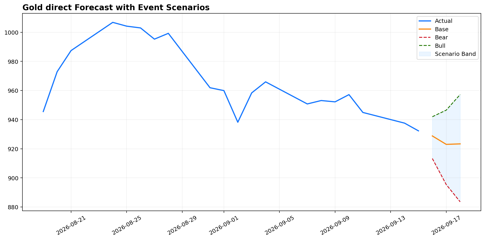
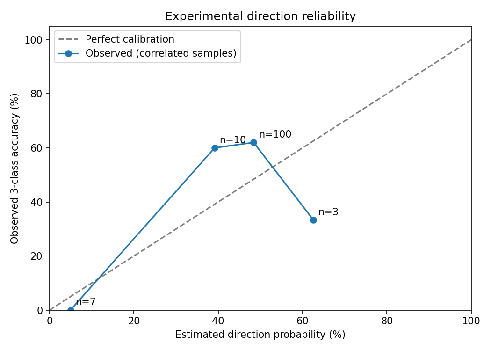

# 黄金方向置信度 v2：严格校准与真实数据复核

运行日：2026-09-16。基础版本：远端 `5f12f9b`，在其之上增加方向置信度层。

## 汇报版

修复的是置信度含义、校准泄漏和证据不足时的提示，**尚未证明预测能力提高**。固定生产入口不变，未修改 cron、OpenClaw 配置或 memory。

新拉取的最新完整上期所日线为 **2026-09-15，932.30 元/克**。9/16~9/18 为未实现预测，不能当作已验证收益。

|回测期限|组合数|三分类方向命中率|平均方向概率|概率 Brier|简单先验 Brier|
|---|---:|---:|---:|---:|---:|
|T+1~3|36|41.67%|46.35%|0.5177|0.5038|
|T+5~10|72|68.06%|44.89%|0.5154|0.5038|
|全部 T+1~10|120|57.50%|45.45%|0.5186|0.5038|

目标窗口 8/31~9/15，共 12 个交易日；120 条记录有重叠，不是 120 笔独立试验。涨/跌/平阈值为相对预测起点 +/-0.5 元。三分类 Brier 越低越好。

原始校准分类器三分类 Brier 为 0.4747（短期 0.5051，长期 0.4612），也优于当前收缩概率。**因此不能称新版概率更准确或校准成功。** 固定分桶与先验未根据此测试窗口择优调参。所有 120 条均为 watch；概率超过 60% 的 3 条只有 1 条命中，其他证据条件仍阻止它们成为 supported。

## 本轮改动

1. 保留远端的标签成熟时间 purge、外部行情 available_at 过滤、样本外偏差校正和全量价格模型重训。
2. 合并时发现：若用全量重训分类器重新计算校准数据，会把训练内分数当成样本外分数。现在保存重训前分类器，其校准分数与实时分数使用同一个模型，价格模型仍正常全量重训。
3. 校准样本按真实 origin/target 日期选择不重叠区间，而非简单按行号跨步，防止缺失数据导致标签错位。
4. confidence 是最终价格方向对应的三分类概率估计；旧模型强度单独存入 legacy_confidence_score，不能当作命中率。
5. 输出三类概率、90% 后验频率区间、桶样本量、watch 原因和 experimental_not_validated 标记。小样本、概率冲突和证据不足均观望。
6. 新增逐期限、逐方向、逐概率门槛的覆盖率与命中率审计，拒绝把旧评分或非法概率纳入概率评估。

## 和上一版的区别

历史 v1 的短期/长期三分类命中率为 69.44%/79.17%，当前为 41.67%/68.06%。两者价格训练基础不同：当前保留远端 5f12f9b 的时间边界与偏差校正修复，不能据此认定置信度层使价格变差，也不能继续沿用旧指标。

置信度层不参与价格和 guard 计算，回退不改变价格的回归测试已通过。但尚未逐条运行纯 5f12f9b 作为同一冻结数据上的完整对照，不能作更强的因果归因。

## 逐期限审计

|期限|原组合数|三分类命中率|剔除重叠后的数量|剔重命中率|90% Wilson 区间|
|---|---:|---:|---:|---:|---|
|T+1|12|33.3%|12|33.3%|15.9%~56.9%|
|T+2|12|41.7%|6|16.7%|3.8%~50.2%|
|T+3|12|50.0%|4|75.0%|35.6%~94.2%|
|T+5|12|83.3%|3|100.0%|52.6%~100.0%|
|T+10|12|58.3%|2|50.0%|12.1%~87.9%|

先剔重再按涨跌与门槛分组，避免按方向筛选后人为留下相互重叠的样本。所有分组样本少于 30，标记 insufficient_evidence；跨期限及同一市场状态仍相关，Wilson 区间不是消除市场相关性的保证。

## 固定生产入口预测

基准价 932.30 元/克；价格方向均相对同一基准，不是相对前一预测日。

|目标日|基础预测元/克|方向|涨概率|跌概率|平概率|所选方向90%区间|桶样本|状态|
|---|---:|---|---:|---:|---:|---|---:|---|
|9/16|928.79|跌|43.6%|48.3%|8.1%|35.9%~60.7%|33|观察|
|9/17|923.01|跌|49.0%|49.0%|2.1%|32.5%~65.5%|14|观察|
|9/18|923.35|跌|51.5%|45.6%|2.9%|26.5%~65.2%|7|观察|

四舍五入可能使展示总和偏离 100%。9/18 的价格方向与概率最高类别冲突，明确标记观望。区间描述校准频率而非价格覆盖率，未包括分布漂移。





## 限制和后续方向

- 短期价格方向仍弱；本次没有通过继续增加价格规则去拟合最近 12 天。
- 长期分桶样本不足且分类器较旧，概率明显收缩。下一步应积累 guard 后最终方向的滚动样本外记录，校准最终任务，而不是仅校准全局分类器。
- 对比固定先验、原始分类器、分桶及逻辑校准时，应使用嵌套时间切分：内层选择校准器，外层独立报告 Brier、log loss、覆盖率和分方向准确率；至少覆盖不同涨跌市场月份。
- 外部日线缺少 available_at 时，沿用次日上海 08:00 的可用性假设。该假设不是已核验发布时间，也未解决行情修订、连续合约与冻结快照的全部偏差。
- 当前实验概率不得被下游 agent 描述为“已验证胜率”；supported 也不是交易许可。

## 验证、调用与回退

21 项测试通过，覆盖标签成熟、外部数据未来值隔离、重训前校准模型身份、概率合法性、方向筛选前剔重、价格回退不变性以及 Kronos 组合。

```bash
MPLCONFIGDIR=/tmp/mpl-stock .venv/bin/python -m pytest \
  tests/test_gold_integrity.py tests/test_kronos_combination.py \
  scripts/test_direction_confidence.py scripts/test_gold_continuation.py \
  scripts/test_confidence_evaluation.py -q

scripts/run_gold_direct_report.sh /tmp/gold-report 2026-09-18
GOLD_DIRECTION_CONFIDENCE_MODE=legacy scripts/run_gold_direct_report.sh /tmp/gold-legacy 2026-09-18

.venv/bin/python scripts/evaluate_direction_confidence.py \
  report/gold_confidence_2026-09-16/v2/records.csv \
  --output /tmp/gold-confidence-audit
```

固定 wrapper 实跑成功并生成 manifest、Markdown、CSV、JSON、PNG。运行环境仅有现存 Pyparsing/LibreSSL 警告。`legacy` 仅回退评分语义；若需要撤回整个代码变更，使用本次独立 Git 提交回退，不更换生产入口。

完整证据：`v2/records.csv`、`v2/confidence_metrics.csv`、`v2/confidence_reliability.csv`、`v2/direction_threshold_audit.csv` 和 `v2/production_scenario.csv`。父目录其余结果为合并前 v1 历史记录。
