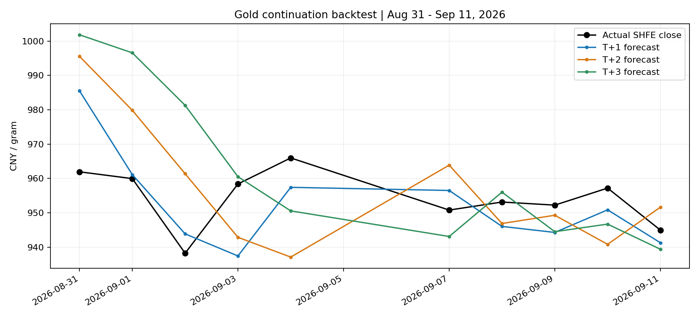

# 黄金续接回测与工程改进：2026-09-12

## 汇报版

本轮重新拉取数据，SHFE 日线最新完整日期为 2026-09-11，共 4551 行。
COMEX 928 行、USDCNY 961 行、DXY/VIX 各 928 行、美国十年期利率 926 行。
评估 V3 direct + guards，保留生产入口和全部预测权重。
本轮优化属于计算复用与回测正确性改进，不能声称提高预测准确率。

| 目标窗口 | 周期 | 样本数 | 方向准确率 | MAPE | 平均信心评分 |
|---|---|---:|---:|---:|---:|
| 9/7—9/11 | T+1～T+3 | 15 | 60.0% | 0.77% | 50.7 |
| 9/7—9/11 | T+5～T+10 | 30 | 86.7% | 2.57% | 20.5 |
| 8/31—9/11 | T+1～T+3 | 30 | 60.0% | 1.50% | 43.2 |
| 8/31—9/11 | T+5～T+10 | 60 | 76.7% | 2.45% | 22.0 |

两个窗口嵌套，不是独立验证集。多个起点预测同一目标，样本相互重叠；
最近一周仅五个独立目标交易日。评分取值 0～100，并非成功概率或区间覆盖率。

## 两周逐周期结果

| 周期 | 样本数 | MAE（元/克） | MAPE | 方向准确率 | 平均信心评分 |
|---|---:|---:|---:|---:|---:|
| T+1 | 10 | 9.07 | 0.95% | 60% | 56.0 |
| T+2 | 10 | 16.64 | 1.74% | 50% | 41.5 |
| T+3 | 10 | 17.15 | 1.80% | 70% | 32.0 |
| T+4 | 10 | 18.22 | 1.91% | 90% | 26.3 |
| T+5 | 10 | 19.14 | 2.01% | 90% | 27.1 |
| T+6 | 10 | 21.09 | 2.21% | 90% | 23.7 |
| T+7 | 10 | 16.55 | 1.74% | 80% | 25.3 |
| T+8 | 10 | 23.91 | 2.51% | 80% | 20.9 |
| T+9 | 10 | 30.01 | 3.15% | 70% | 18.0 |
| T+10 | 10 | 29.47 | 3.09% | 50% | 16.9 |

图中每条预测按自己的目标日绘制，不是一次起点产生的整条未来路径。
方向相对于各自预测起点的实际价格判断。
逐条明细与逐周期汇总在同目录 CSV 中，可独立复核。

## 诊断与下一步

1. 短期方向仍弱：T+2 两周只有 50%，单周 40%。不应根据五天结果增加模型自信；优先使用独立滚动窗口校准，并与不变价格、动量基线比较。
2. 长期方向不代表幅度可靠：最近一周 T+9 方向全部正确，MAPE 却为 3.75%；T+10 为 4.94%。应单独评估冲击后的幅度响应与反弹释放，再在留出窗口验证。
3. 时间口径是重要限制：当前跨市场日线以日期截断，同一美国交易日日线收盘可能晚于上金/沪金当日 16:00。结果不是严格的 16:00 point-in-time 回测。下一步为数据加入实际可用时间，无法确定时滞后一个交易日，并做新旧口径对照。
4. 模型内部训练/验证按比例切分，长周期标签可能跨越切分边界。应增加 horizon purge，并在严格样本外预测上校准偏差和信心评分。
5. 当前训练优化不跨起点缓存，避免特征随数据窗口变化而污染结果。后续缓存应以输入数据版本和起点共同标识。

## 本轮实现与验证

- 特征仅在同次预测、同一组输入内跨 horizon 复用。
- 只训练 cutoff 后需要评估的周期，逐起点输出耗时和记录数。
- 不再通过返回列表位置推断周期，使用模型 horizon 并验证目标日期。
- 两项回归测试通过：缓存训练输入完全一致、缺失 T+1 时 T+2 不错位。
- 改动前后分别拉取数据运行最近一周窗口，50 行预测 CSV 逐字节一致。
- 两周窗口完成 100 条预测；最近一周逐起点计算耗时合计约 64 秒，不含数据获取。没有精确的同条件旧版计时，故不声明加速倍数。
- 生产 wrapper 成功运行并生成 report/CSV/PNG/JSON，manifest 标记 gold_direct_v3。

## 生产输出检查

基准：9/11 SHFE 收盘 944.94 元/克。

| 目标日期 | 预测价（元/克） | 相对基准方向 | 模型信心评分 |
|---|---:|---|---:|
| 9/14 | 931.96 | 下跌 | 90.0 |
| 9/15 | 923.85 | 下跌 | 75.4 |
| 9/16 | 935.76 | 下跌 | 22.6 |

这不是回测结果，只是尚未实现的生产预测。9/16 比前一预测日反弹，但仍低于基准。
此次运行的夜盘分钟数据末标签为 9/14 00:00，晚于运行日期 9/12；
可能涉及供应商交易日映射，尚未核实，不能当成已发生的未来行情。
事件层也缺少足够历史校准，不能把情景幅度或评分解释为可靠概率。
生产输出仅作链路检查，在修复数据可用时间口径前应谨慎使用。

## 回退与调用

生产入口仍为 `scripts/run_gold_direct_report.sh`，未改 cron、OpenClaw memory 或模型选择。
回退可撤销本轮提交，恢复优化前实现；没有迁移数据格式，也没有覆盖既有报告。
调用和测试命令见根 README。重跑应设置新的输出目录，以保存各次数据版本下的结果。
