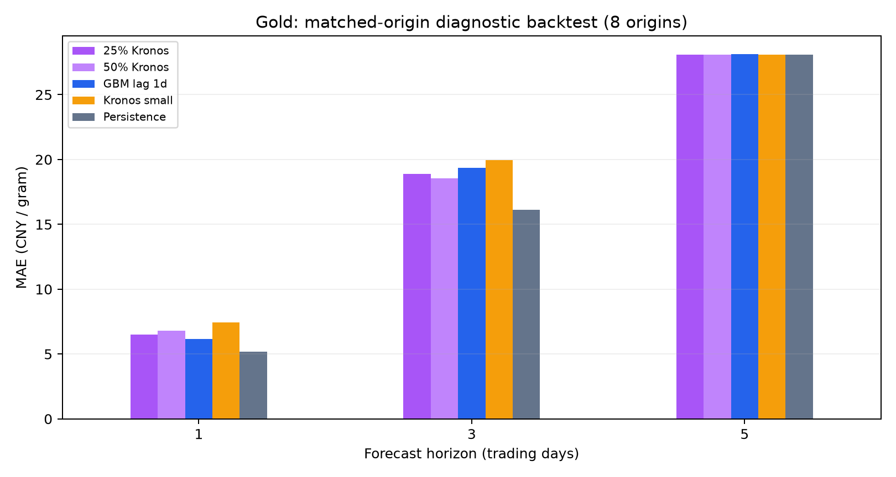

# 黄金回测与 Kronos 接入审查（2026-09-06）

本轮小样本不支持提高 Kronos 权重或用它替换现有模型：官方 Kronos-small 的 128/240 日线上下文和固定权重融合均未胜过价格不变基线。优先修正外部信息时间对齐、GBM 验证标签隔离和最终重训，再扩大共同样本评估。该结论仅适用于下述实验配置与 8 个起点。

## 实验范围与复现

> 后续实施已修改主预测代码。复现本页 2026-09-06 的旧实验时，应使用基准提交 `c74f7d2` 的模型源码；当前改进实验见 `docs/GOLD_RESEARCH_WORKSTATE.md`。

项目基准提交：`c74f7d2`。本次不修改生产预测逻辑。

- 重新获取新浪 AU0 日线 4,546 根（2008-01-09 至 2026-09-04）、Yahoo COMEX、USDCNY、DXY、VIX、US10Y 数据；保存 CSV 与 SHA256。
- 新运行：8 个起点（2026-07-06 至 2026-08-24，每 5 个交易日取样），每个起点评估 T+1、T+3、T+5，目标日期覆盖 2026-07-07 至 2026-08-31。
- GBM 三组共 72 条新预测，训练窗口 240，按起点截断国内历史和外部数据。未包含 COT、新闻/情景覆盖层。
- 官方 Kronos-small：两种上下文（240、128），每种 8 个起点 × 3 个种子，共 48 次推理；每次平均 8 条采样路径，记录 T+1/T+3/T+5，共 144 条“种子内均值”记录。不是 144 个独立时间样本。
- 另复算两份已有 continuation CSV 共 250 条预测，并核对其目标收盘价与本次抓取数据一致。这部分不是重新训练，也不是独立前瞻测试。
- 基线为预测未来收盘等于起点收盘。MAE 单位为元/克；skill = 1 − 模型 MAE / 基线 MAE。价格不变基线是中性预测，其方向命中率不适合与涨跌模型直接排名。
- 原始数据是当前抓取的历史序列，不是逐日封存的 point-in-time 数据；跨市场延迟一天是保守诊断，不等价于完整的交易所时间戳对齐。

在项目根目录执行（本机环境为 `/tmp/gold-backtest-venv/bin/python`）：

```bash
/tmp/gold-backtest-venv/bin/python report/review_20260906/audit_archives.py
/tmp/gold-backtest-venv/bin/python report/review_20260906/fresh_backtest.py
```

复现使用本目录 `data/` 快照；不要先执行 `fetch_data.py`，否则会更新快照。依赖版本和数据校验值见 `manifest.json`。新环境需要 numpy、pandas、scikit-learn；重新抓取还需要 akshare、yfinance、matplotlib。

## GBM 新回测

每个单元格都是相同的 8 个起点；数值为 MAE，越低越好。

| 预测方法 | T+1 | T+3 | T+5 |
|---|---:|---:|---:|
| 价格不变基线 | 5.17 | 16.12 | 28.07 |
| 当前 GBM | 6.47 | 17.80 | 24.72 |
| 外部数据延迟一天 | 6.18 | 19.37 | 28.11 |
| 延迟一天 + 跳跃/趋势信号置零 | 6.96 | 17.07 | 27.34 |

当前 GBM 方向命中率分别为 87.5%、37.5%、75.0%；延迟外部数据后为 62.5%、37.5%、37.5%。T+1 即使命中率很高，价格误差仍可能比基线差，两种指标不能互相替代。

T+5 当前模型相对基线改善约 11.9%，延迟一天后改善消失。这个实验同时改变训练样本与推理时的外部信息可用日期，说明结果对时间对齐敏感，不能据此直接断言全部差异都来自未来信息。关闭跳跃/趋势信号的作用也不一致，不建议整体删除分支。

这些是探索性诊断：每个周期只有 8 个起点，多个周期共享起点与目标信息；没有做收益/手续费/滑点回测，没有统计显著性结论，也未覆盖所有市场状态。

## 旧记录复核

最近窗口（目标为 2026-08-24 至 2026-09-04，每周期 10 条）：

| 周期 | 原有模型 MAE | 价格不变 MAE | 相对改善 |
|---|---:|---:|---:|
| T+1 | 7.98 | 12.37 | 35.5% |
| T+2 | 19.56 | 19.28 | -1.4% |
| T+3 | 25.10 | 27.16 | 7.6% |
| T+5 | 35.98 | 41.48 | 13.3% |
| T+10 | 31.44 | 30.89 | -1.8% |

预先固定的 50% 收益收缩在此窗口只略微改善 T+2，多数周期使误差增加；在 5/28 至 6/18 旧窗口也没有普遍获益。因此不推荐统一把所有预测幅度减半。窗口差异也说明应报告分阶段结果，而不是挑选最好的一周。明细见 `archive_comparison.csv`。

## 优先改进现有评估与模型

1. **P0：按真实可用时间连接外部数据。** `ml-service/models/multi_bar_features.py:277` 按 `date <= target_date` 取 COMEX、汇率及美股市场指标。若预测时点为中国下午，当天美盘完整日线尚不可用。增加 `available_at`、时区与源市场收盘时间，使用向后 as-of join；记录每项输入的实际时间戳与缺失情况。Kronos/GBM 对比必须使用相同预测时点。
2. **P0：验证集隔离与最终重训。** `multi_day_direct_predictor.py:1359` 的 80/20 分割没有按预测周期清除交叠标签。T+5 最后训练标签会越过首个验证起点。按周期 purge 至少 h−1 根，使训练标签终点不晚于验证起点，并采用滚动验证。另在验证结束后，用全部已成熟标签重新训练用于当前预测的模型；目前返回的是只在前 80% 上训练的模型。以 9/4 数据和 240 窗口为例，各周期最后训练标签停在 6/30，遗漏最近约 48 个可训练样本。校准指标仍须来自未参与该轮拟合的数据。
3. **P0：失败和回退必须进入报告。** `rolling_backtest_direct` 使用 `except Exception: continue`，会静默跳过失败起点。固定预期起点集合、记录异常、缺失率、实际模型/回退类型；所有模型在共同有效样本上比较，同时单列覆盖率。本次新脚本遇异常直接失败，未使用静默跳过逻辑。
4. **P1：约束人工规则与调参。** 保留原始 GBM、规则调整后预测及各分支贡献；按时间分开开发、验证和最终测试。仓库已有根据特定失败日期修改 guard 的记录，因此这些日期的回放适合排错，不应当作未见样本证明。针对近期漂移优先测试“全量成熟样本重训”和窗口长度，再决定是否增加规则。
5. **P1：统一指标。** 同时报 MAE、相对基线 skill、方向命中率、信号覆盖率、区间覆盖/宽度；有概率输出时增加 Brier score 和可靠性分箱。按起点做成对比较，采用时间块 bootstrap；不能把同一目标的十种 horizon 当十个独立交易日。若评估交易策略，需要另定义可交易合约、入场时点、换月和成本。

## Kronos：目前代码边界与建议

本项目 main 分支只在 `ml-service/models/gold_api.py` 提及外部 `gold-kronos`，该文件实际调用 GBM；没有用户自定义的 Kronos 推理、融合、模型权重或回测实现。因此以下接入建议不是对该外部项目代码的断言。

官方 Kronos 使用 OHLC 和可选 volume/amount、历史与未来时间戳；small/base 的上下文上限是 512。应明确检查模型与 tokenizer 配对、输入尺度、时间顺序和历史窗口，避免将未来价格/成交量用于预处理。见 [官方说明](https://github.com/shiyu-coder/Kronos/blob/master/README.md)。

- **数据契约先行。** 保存 AU0 连续合约构造/换月信息，核对 OHLC、成交量单位、夜盘交易日归属。当前日线采集未提供 amount；官方会用 OHLC 均价乘 volume 估算，该值是代理变量，不是真实成交额。需要比较代理值、真实成交额与缺失量价信息的敏感性，不能直接用美元金价和人民币金价混训而不记录单位。
- **先测零样本，再测融合/微调。** 在共同起点上比较价格不变、GBM、Kronos、小权重融合；按 T+1/T+3/T+5 单独评分。融合权重只能在较早验证段选择，最后测试段锁定；没有样本外增益的周期允许 Kronos 权重为零。不能因为基础模型规模更大就默认替换 GBM。
- **保存采样输出。** 固定模型 revision、seed、temperature、top_p、sample_count。官方 predict 的多路径会在内部平均，平均曲线本身不能给出可信区间；若要区间，需保留单独路径，并用样本外残差校准。多种子平均值之间的波动也不等同于未来价格分布。见 [官方实现](https://github.com/shiyu-coder/Kronos/blob/67b630e67f6a18c9e9be918d9b4337c960db1e9a/model/kronos.py)。
- **增加真正未见的测试段。** 至少扩大到多个季度与趋势、震荡、急跌/反弹阶段，检查预训练及后续微调截止日期。微调只使用历史训练段，不应在这 8 个起点上调整参数后再报告为测试提升。
- **可复现与服务质量。** 记录推理耗时、缺失率、回退原因；批处理需要统一历史长度和预测长度。保证跨模型比较的 target_date 与 horizon 显式对应，不能假设稀疏返回的第 2 项一定是 T+2。

## 官方 Kronos 独立实测

以下已经实际加载官方权重并运行，不代表用户外部 `gold-kronos` 集成版本。模型代码提交为 `67b630e67f6a18c9e9be918d9b4337c960db1e9a`，模型和 tokenizer 的 Hugging Face revision 记录在 `manifest.json`，下载脚本固定这些版本。

统一设置：CPU、2 线程、eval 模式、T=1.0、top_p=0.9、seed=17/29/43，每个 seed 的 sample_count=8；三个输出均值再平均，相当于 24 条路径均值。模型仅输入截止起点的国内 OHLCV，未来输入只有目标交易日时间戳，没有微调。240 根上下文每次约 2.2 秒，128 根约 1.2 秒（不含下载和模型加载）。

| 方法 | T+1 MAE | T+3 MAE | T+5 MAE |
|---|---:|---:|---:|
| 价格不变 | 5.17 | 16.12 | 28.07 |
| GBM，外部数据延迟一天 | 6.18 | 19.37 | 28.11 |
| Kronos-small，240 根上下文 | 7.45 | 19.93 | 28.08 |
| Kronos-small，128 根上下文 | 7.58 | 20.95 | 32.60 |
| 75% 延迟 GBM + 25% Kronos（240） | 6.50 | 18.90 | 28.10 |
| 50% 延迟 GBM + 50% Kronos（240） | 6.81 | 18.55 | 28.09 |



240 根上下文 Kronos 的方向命中率为 62.5%、50.0%、62.5%。在 T+5，它的方向命中率高于延迟 GBM 的 37.5%，但价格 MAE 几乎一样。不能单凭方向率提升判断已产生可交易收益。

随机种子也影响判断：240 上下文下，T+1 各种子 MAE 为 6.68 / 9.06 / 6.97；T+5 方向命中率为 62.5% / 37.5% / 75.0%。128 上下文的 T+5 MAE 则为 34.54 / 28.38 / 36.01。缩短上下文没有在这轮获得改善。128 对照是在完成 240 后追加的探索，不能作为独立测试选参依据。

固定 25%/50% 融合在 T+3 略低于两个组成模型的 MAE，但仍未胜过价格不变；T+1 变差，T+5 基本不变。因此建议按周期验证融合增益，当前没有证据支持给 Kronos 设置统一的较高权重。

复现（提前准备上面固定提交的官方代码目录）：

```bash
/tmp/gold-backtest-venv/bin/python report/review_20260906/download_weights.py
/tmp/gold-backtest-venv/bin/python report/review_20260906/kronos_backtest.py --kronos-dir /tmp/gold-kronos-official
/tmp/gold-backtest-venv/bin/python report/review_20260906/kronos_backtest.py --kronos-dir /tmp/gold-kronos-official --lookback 128
/tmp/gold-backtest-venv/bin/python report/review_20260906/summarize_kronos.py
```

权重保存在临时目录，不进入本仓库。运行器可通过 `--weights-dir` 指定本地权重位置。`kronos_seed_predictions.csv` 为各种子内 8 路均值，`kronos_predictions.csv` 为 24 路均值；128 上下文结果在 `context128/`。这些文件没有保留单条路径，因此不从它们估计预测区间覆盖率。

下一轮建议顺序：①修复 GBM 的数据时点与重训；②锁定各模型版本，在更长时间段做按月滚动共同起点测试；③在更早的验证段选择上下文、采样数量及每个周期融合权重，最后测试段只评价一次；④只有在零样本表现和输入单位审查明确后，再尝试黄金专门微调与区间校准。
