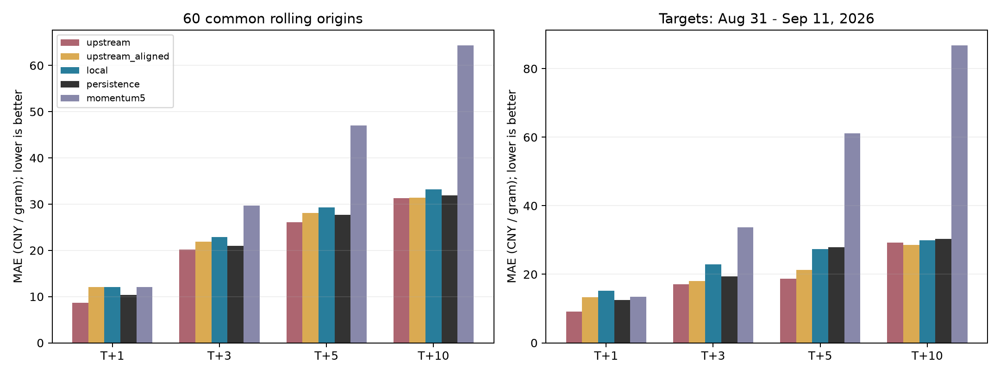

# 黄金程序同步与回测复核

2026-09-13 执行同步与训练，2026-09-14 完成汇总。结论：修正外部信息可用时点后，没有证据表明当前模型稳定优于价格不变基线；本机已有的训练修复提高了评估规范性，但此次没有带来准确率提升。

项目 `/root/code/codex/stock-prediction` 已从 `c74f7d2` 快进到 rootliu/stock-prediction 的 `8418fad60fef09754df4878423a71e70d53bd8ca`，即 9/13 拉取时 GitHub main 最新提交。本地两份已修改源码与所有未跟踪文件已备份到 `/root/gold-sync-backup-20260913/`，原有修改无冲突恢复。工作区保留这些未提交修改，因此不等于纯 GitHub 版本；本轮未提交、推送或切换生产模型。

本轮重新训练了三组模型，每组 69 个起点、261 条预测，共 783 条。各组起点、实际价格和周期完全一致，没有缺失预测；数据、源码哈希验证通过。合并后 12 项 pytest 测试及 2 项 continuation 回归测试通过。

数据为 9/13 抓取的固定快照，沪金 AU0 日线 4,551 条，最后完整交易日 2026-09-11。COMEX、美元指数、VIX、美国十年期利率最新到 9/11；汇率序列带有 9/13 标签，但每个起点均截断，未将这些后续记录用于历史预测。本报告不包含 9/14 新行情。

三个版本：

- `upstream`：GitHub `8418fad` 原版，跨市场数据按日期截断，可能使用中国下午尚未完成的当日美国日线。
- `upstream_aligned`：只为原版加入外部数据可用时点过滤，训练和规则不变。
- `local`：GitHub 更新加本机原有修复，包含可用时点过滤、验证标签成熟隔离、全部成熟标签重训及验证残差偏差校正。

主表使用相同的 60 个起点（2026-06-05至08-28），目标日期覆盖06-08至09-11，每个起点评估 T+1/T+3/T+5/T+10；末尾另有 9 个起点只评估已成熟周期。训练窗口 240，无此次测试段调参，不含新闻、COT 或外部情景融合层。这里评价的是日线 direct 模型，不能代表全部生产报告层或分钟模型。

| 方法 | T+1 MAE | T+3 MAE | T+5 MAE | T+10 MAE |
|---|---:|---:|---:|---:|
| 价格不变 | **10.40** | **20.96** | **27.72** | 31.85 |
| GitHub 原版（时点口径有局限） | 8.65 | 20.16 | 26.10 | 31.31 |
| 原版＋外部时点过滤 | 12.10 | 21.92 | 28.12 | **31.44** |
| 本机合并修复版 | 12.06 | 22.93 | 29.28 | 33.15 |
| 过去5日平均对数收益外推 | 12.03 | 29.66 | 46.98 | 64.39 |

单位元/克，越低越好。加粗只在价格不变及采用外部时点过滤的模型之间比较。价格不变指预测目标收盘等于起点收盘，不是持仓策略。

本机版相对价格不变的 MAE 分别增加 **16.0%、9.4%、5.6%、4.1%**；方向命中率分别为 53.3%、51.7%、41.7%、41.7%。原版 T+1 的 76.7% 方向命中率在仅调整外部时点后降到 51.7%，说明结果对时点假设敏感；不能把原版较好指标直接解释为可实时获得的预测能力。

采用 10 起点移动时间块、2,000 次重采样估计本机版相对基线 MAE 差值的探索性 95% 区间：T+1 [0.68, 2.58]，T+3 [-0.23, 4.83]，T+5 [-0.05, 3.73]，T+10 [0.06, 3.54] 元/克。正值表示模型误差更大。样本有限且未作多重比较调整，不应据此宣称严格统计显著；未发现稳定胜过基线的证据。

最近两周目标日为 8/31—9/11，各周期 10 条记录。本机版 MAE 为 15.14/22.89/27.39/29.87，基线为 12.44/19.32/27.84/30.35。T+5、T+10 仅改善约 1.6%，短周期变差，不足以推翻主窗口结论。最近一周 T+10 平均高估约 49.43 元/克；方向对不等于幅度准。



改进建议按优先级排列：

1. **先建立按周期的模型准入与回退。** 报告固定展示价格不变基线、MAE、相对改善和覆盖率。候选模型只有在预先锁定的独立时间段及多个月份中取得稳定增益，才获准成为默认；否则使用基线中心价并给出经历史残差校准的区间。本轮只是建议，未自动替换生产模型，也未回测一个新选择器。
2. **保留信息时点约束，补真实发布时间。** 当前“次日上海08:00可用”只是缺少发布时间时的明确假设，应逐源采集 available_at、时区、版本和缺失状态，并核实夜盘交易日归属。不能为恢复较好的回测指标而撤销时点过滤。
3. **拆开验证训练修复的效果。** 以 aligned 原版为控制组，分别检验标签 purge、最终重训、验证残差校正和分支重训，再做组合；此次 local 同时包含多项修改，无法定位哪一项导致退化。偏差估计仅使用已成熟的滚动样本外残差，避免少量验证残差过度校正；参数选择放在更早训练/验证段，下一阶段封存评估。
4. **重点检查长周期幅度与市场阶段偏差。** 本机 T+10 在 8 月平均低估49.75、9月截至11日平均高估32.17元/克，存在随行情变化的偏差。分别评估涨跌概率、条件涨跌幅和区间覆盖，避免统一放大趋势。简单5日动量外推也明显落后基线，不建议直接加入作为增强。
5. **不要整体删除 guards，也不要急于加 Kronos 权重。** 同一批记录中本机规则后 MAE 比规则前低（T+10 为33.15对38.80），这里只是同次预测前后诊断，不能证明所有规则都有效；应逐规则做冻结后的消融。9/7 的既有200起点研究中 Kronos 与融合均未胜过价格不变，本轮未重新运行 Kronos，旧结果只作背景。
6. **如需评估赚钱能力，另做可交易合约策略回测。** 当前仅为价格预测评估；需要定义预测后可成交的入场时点、具体月份合约、换月、仓位、费用、滑点和回撤，不能将 AU0 连续序列误差或方向率当成投资收益。上期所黄金报价单位为元/克、交易单位为1000克/手，参见[交易所业务细则](https://www.shfe.com.cn/regulation/exchangerules/productrules/202512/t20251231_829960.html)。

限制：当前抓取的历史序列不是逐日封存的历史版本；连续合约换月与夜盘标签未完整核验；人工规则开发日期可能与回放区间重叠；多个周期与目标重叠，不能把783条记录当作783个独立交易日。最近周与主窗口不是独立试验。9/12 仓库旧报告与本轮快照/执行配置不同，本轮未证明逐条复现旧报告，其指标不与本轮混合计算。

复现与产物：

```bash
cd /root/code/codex/stock-prediction
# 沿用 data/ 快照；不要为复现重新抓取行情。
/tmp/gold-backtest-venv/bin/python report/review_20260913/run_backtest.py --variant upstream
/tmp/gold-backtest-venv/bin/python report/review_20260913/run_backtest.py --variant upstream_aligned
/tmp/gold-backtest-venv/bin/python report/review_20260913/run_backtest.py --variant local
/tmp/gold-backtest-venv/bin/python report/review_20260913/summarize.py
```

本机版复现需匹配 `local_manifest.json` 中源码哈希，源码备份为 `local_source.py`；其他依赖源码亦需匹配，不能混用后续版本。当前脚本重跑覆盖本目录结果，应先复制整个报告目录留档。

`summary.csv`：三个窗口逐模型指标及主窗口区间；`monthly.csv`：逐目标月份诊断；`all_predictions.csv`：模型与基线全部明细；各版本 `coverage.csv`：完整性；`guard_diagnostic.csv`：规则前后误差；`audit.json`、各版本manifest和data/manifest.json：版本与校验信息。所有结果均保存在本目录。
